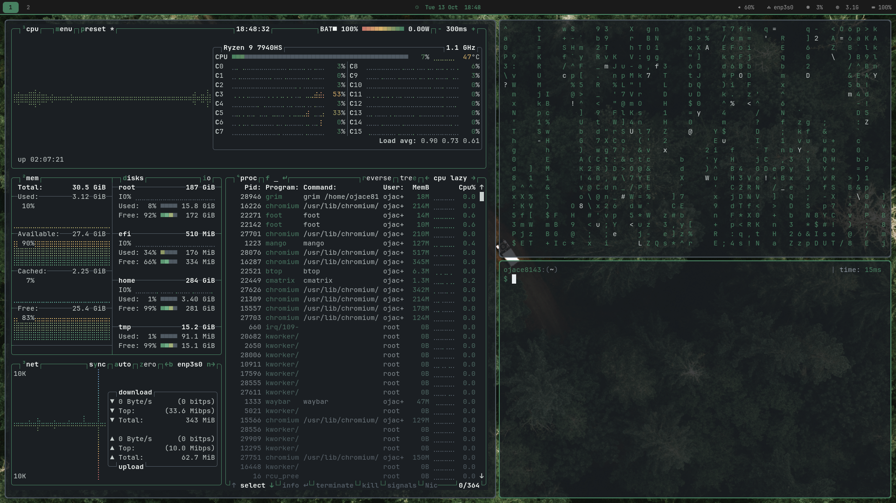
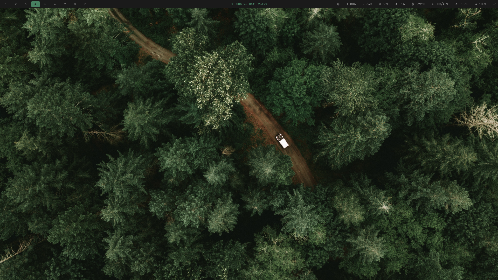

# void-musl-rice
my personal void linux rice, built on musl and working on glibc too, if you want to use it ig

honestly pretty clean if i do say so myself

WARNING: somewhat ai generated reamde

## the deets
mangowm, waybar, fuzzel, foot, dunst, swaylock, swayosd, cliphist

basically it

## install

Void Linux is required for the package and system steps (the configs alone
work anywhere). Both **glibc** and **musl** installs are supported; the
installer detects the platform and checks package availability against the
configured xbps repository.

```sh
git clone https://github.com/ojace8143/void-musl-rice
cd void-musl-rice
./setup.sh (for extra options keep reading)
```

The installer walks through:

1. **Environment** — distro, architecture, glibc/musl, user, shell, sudo.
2. **Mode** — copy/merge, symlink, or clean.
3. **Components** — configs, packages, system integration, font, wallpapers,
   GTK/Qt defaults.
4. **Package groups** — core, session, CLI, theming, apps, extras.
5. **System actions** — udev, limits, `/etc/rc.local`, groups, services.
6. **Review** — every choice is shown before anything is changed.
7. **Backup** — a timestamped `~/rice-backup-<stamp>/` with archives and a
   `MANIFEST`.
8. **Install** — packages first, then system, configs, fonts, wallpaper, and
   desktop defaults, followed by a summary of skipped/manual items.

`fzf` drives the menus. If it is missing, the installer offers to install it
first. The UI loads its palette from `~/.colors`, falling back to this repo's
`.colors`.

### modes

| mode | behavior |
| --- | --- |
| `copy` (default) | copy/merge rice files; keeps app data |
| `link` | symlink managed files from this repo; edits are live |
| `clean` | replace rice-managed config dirs; keeps user data |

```sh
./setup.sh --copy
./setup.sh --link
./setup.sh --clean
```

`clean` never deletes whole mixed dirs. `cmus` keeps its autosave, library, and
playlists; `gh` keeps `hosts.yml`; `opencode` keeps auth, runtime state,
`service.json`, and `node_modules`.

### components

All components are selected by default. Disable them with flags or the fzf
menu:

```sh
./setup.sh --no-packages   # configs only, no xbps-install
./setup.sh --no-system     # skip udev/rc.local/limits/groups/services
./setup.sh --no-font       # skip the JetBrainsMono Nerd Font download
./setup.sh --no-configs    # skip ~/.config, shell files, and .local/bin
./setup.sh --no-wallpaper
./setup.sh --no-gsettings
./setup.sh --components=configs,packages,font
```

System action flags: `--no-udev`, `--no-limits`, `--no-rclocal`, `--no-groups`,
`--no-services`.

The `.local/bin` helpers (`pfetch`, `enshrouded-fg`, `mic-reset`,
`sudo-askpass`) shadow packaged/global versions when `~/.local/bin` is on
`PATH`.

## chromium theme

The installer copies (or symlinks in `--link` mode) the Void Dark theme to
`~/.local/share/chromium-themes/void-dark/`. Chromium's UI theme isn't
auto-applied from a profile directory — load it manually:

1. Open `chrome://extensions/`
2. Enable "Developer mode" (top right)
3. Click "Load unpacked"
4. Select `~/.local/share/chromium-themes/void-dark/`

The theme matches the `~/.colors` palette (Void green accents, dark grays).
Web page content styling is not affected — use Dark Reader if desired.

### package groups

```sh
./setup.sh --package-groups=core,session,cli,theme,apps,extras
```

- **core** — mango, waybar, dunst, foot, fuzzel, screenshots, clipboard, media keys, OSD.
- **session** — pipewire, bluez, portals, seatd, Qt/GTK deps, `pactl`, `notify-send`.
- **cli** — zsh, fzf, git, neovim, btop, cmus, ripgrep, fd, zoxide, eza, bat, python3.
- **theme** — Qt5/Qt6, Qt Wayland, Arc, Papirus, Nerd Font symbols, Noto emoji, DejaVu.
- **apps** — chromium, imv, mpv, zathura, impala, bluetui, pavucontrol.
- **extras** — flatpak.

Only missing packages are installed. Packages unavailable in the current
repository are reported and skipped instead of failing the whole transaction.

### non-interactive / testing

```sh
./setup.sh --yes
./setup.sh --yes --no-packages --no-system
./setup.sh --link --yes
./setup.sh --dry-run --yes
```

`--yes` uses copy+merge and selects all components, package groups, and system
actions unless flags say otherwise. `--dry-run` prints every action and changes
nothing, including not creating the backup directory. `--no-color` gives plain
output.

Use `--backup-dir DIR` to choose the backup location, or `--no-backup` to skip
it (not recommended).

### restore

Each backup contains `config.tar.gz`, `shell-rc.tar.gz`, `local-bin.tar.gz`,
`wallpaper.tar.gz`, `fonts.tar.gz` when applicable, and `system.tar.gz` when
root was available. Restore everything with:

```sh
./setup.sh --restore ~/rice-backup-20261026-220000
```

The same `tar -xzf` commands are written to `MANIFEST`, so a backup is
restorable even without the installer. `system.tar.gz` needs `sudo`; the
installer handles that for you when you use `--restore`.

## config mirroring

Everything under `.config/` in this repo is installed to `~/.config/`, except
the app-state files listed below — the installer loops over the whole
directory, so adding a new config dir here needs no `setup.sh` changes. With
`--link` they become symlinks, so edits are immediate.

Directories that mix rice config with user data are handled specially in every
mode:

- `cmus` — only `rc`; `autosave`, `lib.pl`, playlists, and history stay local.
- `opencode` — only `opencode.jsonc`, `tui.json`, `cli.json`, and `themes/`;
  auth, `service.json`, package files, and `node_modules` stay local.
- `gh` — only `config.yml`; `hosts.yml` (OAuth token) stays local.
- `QtProject.conf` — skipped as app state; it stores recent-file paths, not
  rice config.

Not tracked on purpose: `chromium`, `dconf`, `pulse`, and `procps` (machine
state), plus shell histories, caches, SSH keys, and the opencode service
password. `.gitignore` also blocks `auth.json`, tokens, `.env` files,
`gh/hosts.yml`, and `opencode/service.json`.

## system files

`setup.sh` installs, after backing up the existing files:

- `/etc/udev/rules.d/90-backlight.rules` and `90-fan.rules` so the `video` group can control the backlight and the ASUS fan curve without elogind.
- `/etc/security/limits.d/20-nofile.conf` for a high open-file limit (Proton/Wine).
- a small block in `/etc/rc.local` that creates `/run/user/$UID` at boot (there is no elogind here); the file is created executable if missing.
- group membership for `video`, `input`, and `_seatd`, plus the `dbus`, `polkitd`, `bluetoothd`, and `seatd` services.

If setup can't get root, it prints the manual commands and carries on with the
user-level install.

## desktop
- **waybar:** workspaces, MPRIS, bluetooth, network, audio, backlight, CPU, CPU temp, fans, memory, battery, idle inhibitor, tray.
- **OSD:** SwayOSD handles volume, microphone, brightness, and media keys.
- **clipboard:** cliphist + wl-clip-persist; `SUPER+V` opens the picker.
- **power menu:** `SUPER+Escape` (lock / logout / suspend / reboot / shutdown). Because this setup uses seatd instead of elogind, `polkit-gnome` cannot determine a login session; root actions fall back to a `foot` + `sudo` prompt. If you switch to elogind, enable the polkit agent line in `config.conf`.
- **night light:** `SUPER+CTRL+N` toggles gammastep at 4000K.
- **notifications:** dunst, themed to match.
- **themes/fonts:** Arc-Dark, Papirus-Dark, and JetBrainsMono Nerd Font, applied through gsettings and the Qt configs.
- **file defaults:** images → imv, video → mpv, PDF → zathura; Chromium stays the browser.
- **lock screen:** swaylock with an ImageMagick-pre-blurred wallpaper. Tune with `SWAYLOCK_BLUR` (default 14), `SWAYLOCK_BRIGHTNESS` (default 65), and `SWAYLOCK_WALLPAPER`; the cache key includes the blur/brightness values.
- **screenshots:** `Print` fullscreen, `SHIFT+Print` region, `CTRL+SHIFT+Print` window, `CTRL+Print` clipboard, `SUPER+Print` annotate. Saved shots get a notification.
- **recording:** `SUPER+SHIFT+R` region, `SUPER+ALT+R` full screen; press again to stop.

## colors
`~/.colors` is the palette reference (void-dark, accent = Void green `#478061`).
The installer also reads it for its own output and the fzf menu colors. The
consumers are still hand-synced — foot, waybar, dunst, fuzzel, swaylock, btop,
Qt, nvim, and `bat` each embed their own copy. It is not a generated theme.
`bat` reads `.config/bat/themes/void-dark.tmTheme` (selected via `BAT_THEME`;
`cat` / `catn` / `catp` are the aliases).

`pfetch` is themed to match: it's vendored in `.local/bin/pfetch` (a patched
pfetch 0.6.0) with truecolor art/palette and text colors from `.colors` — labels
`VD_GRAY`, data `VD_FG`, title `VD_GREEN_BR`. Vendoring means it renders
on-scheme even in terminals that aren't foot. Override the text colors with full
escape sequences via `PF_LABEL`, `PF_DATA`, `PF_TITLE`.

## fans
Hold `` ` `` and press `1` / `2` / `3` to raise, lower, or return both fans to
automatic (10% steps, normal notification on each change). The waybar module
shows `<fan icon> left%/right%` (left = CPU fan, right = GPU fan). In automatic
mode the percentage is estimated from the measured RPM after a one-time
`fanctl.sh calibrate` run, because the firmware does not expose its PWM value.

If the module ever reads `0%/0%` while the fans are clearly spinning:

```sh
rm ~/.cache/fanctl/calibration
~/.config/mango/scripts/fan/fanctl.sh calibrate
```

The script now ignores implausible RPM samples (outside 500–12000) so one bad
reading can't permanently poison the estimated maximum.

## binds
The full list is in `~/.keybinds`; `SUPER+/` opens it in `foot`.

```
Meta+Q           -- Terminal
Meta+Return      -- Dropdown terminal (named scratchpad)
Meta+W           -- Close Window
Meta+Space       -- Start Menu/Fuzzel
Meta+D           -- Run Command (dmenu equivalent in dwm)
Meta+Shift+Enter -- Chromium/Browser
Meta+V           -- Clipboard history
Meta+Escape      -- Power menu
Meta+/           -- Keybinding cheat sheet
PrtSc            -- Screenshot
Shift+PrtSc      -- Select Screenshot Area
Meta+PrtSc       -- Annotate screenshot
```

Volume up/down, mute, brightness, keyboard backlight, and media keys should work
as normal. Depending on your keyboard, you may have to change a few things.

## waybar clicks
- workspaces: activate / deactivate tag
- MPRIS: left play/pause, middle previous, right next
- bluetooth: bluetui or `bluetoothctl`
- network: impala or `iwctl`
- volume: pavucontrol, pulsemixer, or `alsamixer`
- battery: power menu
- idle inhibitor: left click toggle

Keyboard equivalents: `SUPER+CTRL+A` audio, `SUPER+CTRL+B` bluetooth,
`SUPER+CTRL+W` Wi-Fi.

## screenies



## ai use
pretty heavy ai use. had it fine tune configs, write the readme, and clean everything up to make it readable.
